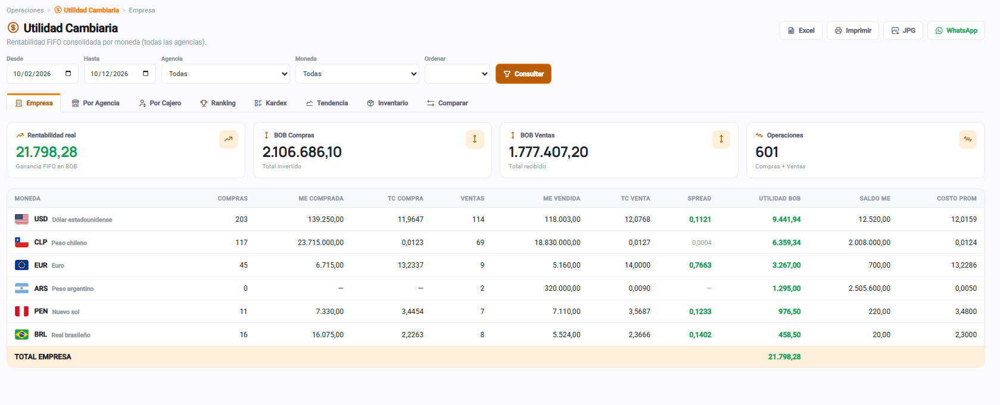
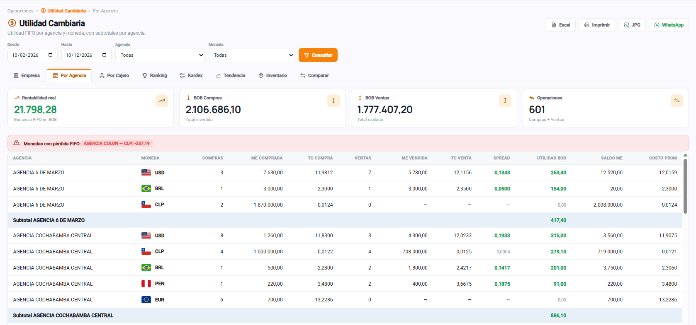
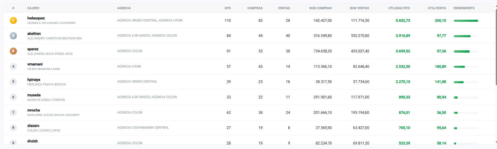
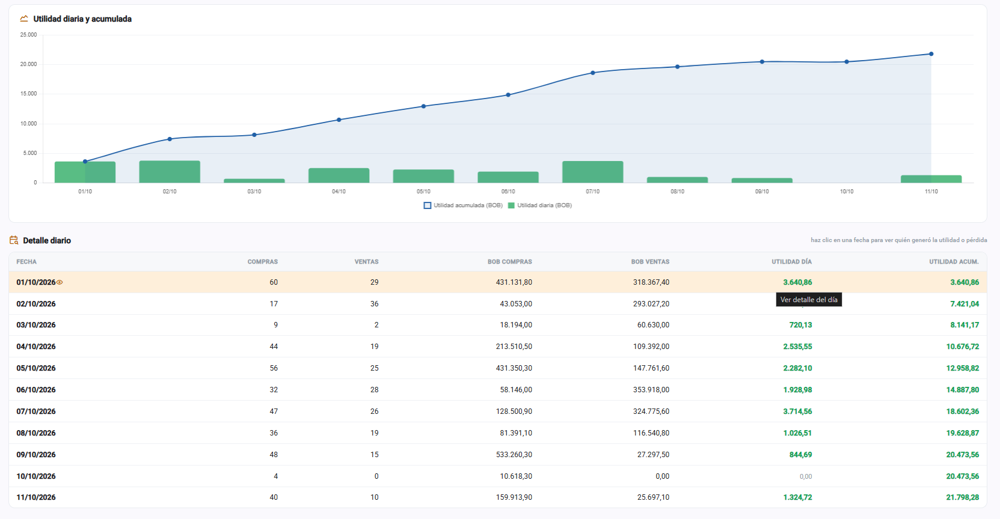
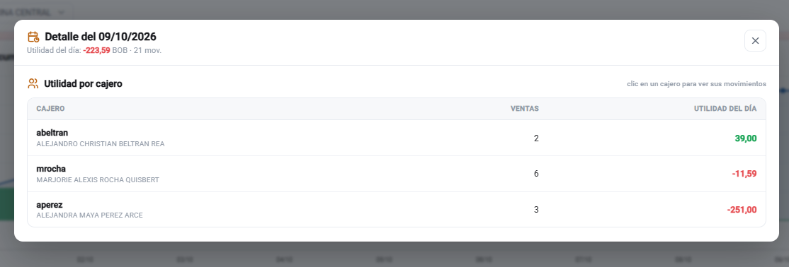
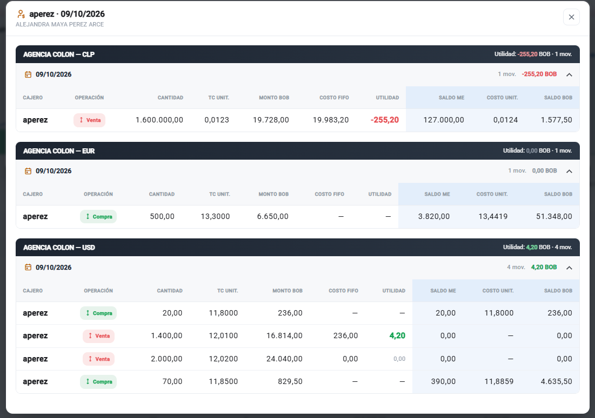

# Nota de Entrega — Módulo *Utilidad Cambiaria*

**Para:** Gerencia
**Fecha:** 12/10/2026
**Estado:** Entregado · Operativo

---

## 1. Qué es

Nuevo módulo que mide la **rentabilidad real de las operaciones de cambio de moneda** usando costeo **FIFO** (primero en entrar, primero en salir), valorizando el inventario sobre el saldo de bóveda. Responde con exactitud a: *¿cuánto ganamos?*, *¿en qué agencia?*, *¿qué cajero?* y *¿cómo evoluciona día a día?*.

**Acceso:** menú lateral → **Operaciones → Utilidad Cambiaria**.

---

## 2. Vistas disponibles (8 pestañas)

| Pestaña | Para qué sirve |
|---|---|
| **Empresa** | Utilidad consolidada por moneda (todas las agencias). |
| **Por Agencia** | Utilidad por agencia y moneda, con subtotales. |
| **Por Cajero** | Utilidad atribuida a cada cajero. |
| **Ranking** | Clasificación de cajeros por utilidad generada. |
| **Kardex** | Detalle contable lote por lote (entradas, salidas, saldo). |
| **Tendencia** | Evolución de la utilidad diaria y acumulada (gráfico). |
| **Inventario** | Posición valorizada al costo FIFO y a valor de mercado (ganancia/pérdida no realizada). |
| **Comparar** | Período actual vs. período anterior. |

Filtros comunes: rango de fechas, agencia, moneda, cajero (buscador) y orden.

---

## 3. Funciones clave

- **Alertas de pérdida:** resalta en rojo las monedas/agencias con utilidad FIFO negativa.
- **Análisis en profundidad (drill-down):**
  - En **Ranking / Por Cajero** → clic en un cajero muestra sus movimientos.
  - En **Tendencia** → clic en una fecha muestra **quién generó la utilidad o la pérdida** de ese día; clic en el cajero abre el detalle de sus operaciones.
- **Exportación:** **Excel**, **Imprimir/PDF** (con logo y fecha) e **imagen JPG** lista para **enviar por WhatsApp**.
- **Responsive:** se adapta a móvil y aprovecha todo el ancho de pantalla.

---

## 4. Cómo ayuda a la empresa

- **Rentabilidad real, no solo volumen:** muestra la ganancia efectiva (FIFO) por operación, moneda y agencia, no únicamente cuánto se operó.
- **Detección temprana de pérdidas:** alerta las monedas o agencias que están perdiendo, para corregir cotizaciones a tiempo.
- **Control por cajero y agencia:** base objetiva para evaluar desempeño, definir incentivos y detectar desviaciones.
- **Trazabilidad diaria:** permite identificar qué día y qué cajero originó una utilidad o una pérdida.
- **Mejores decisiones de precio:** indica el valor actual del inventario y el tipo de cambio mínimo de venta para no perder.
- **Información a la mano:** reportes listos para compartir por WhatsApp o PDF, agilizando la toma de decisiones.

Las cifras se calculan con metodología **FIFO estándar** y fueron verificadas con exactitud. El módulo es de **solo lectura**: no altera ninguna operación.

---

## 5. Capturas de pantalla

**Consolidado por moneda (Empresa)**

**Utilidad por agencia, con alerta de pérdidas**

**Ranking de cajeros por utilidad**

**Tendencia diaria y acumulada**

**Detalle del día: quién generó la utilidad o pérdida**

**Movimientos del cajero en el día**

---

## 6. Resumen técnico

- **Frontend:** nuevo módulo en la plataforma de reportes (Angular), consistente con el diseño del sistema.
- **Backend:** nuevo servicio de cálculo FIFO y endpoints de consulta (solo lectura), integrados a la API existente con el control de accesos por rol.
- **Alcance:** reporte de consulta; no realiza modificaciones sobre las operaciones.

---

*Como valor agregado, la pestaña **Diferencias de Caja** (Administración Operativa) también incorpora la exportación a imagen JPG / WhatsApp.*
